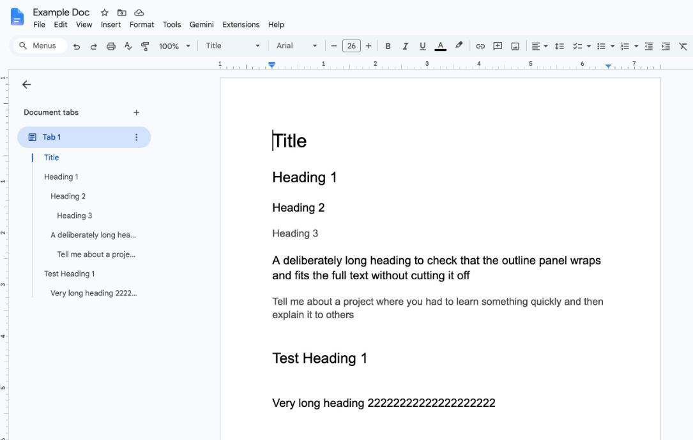
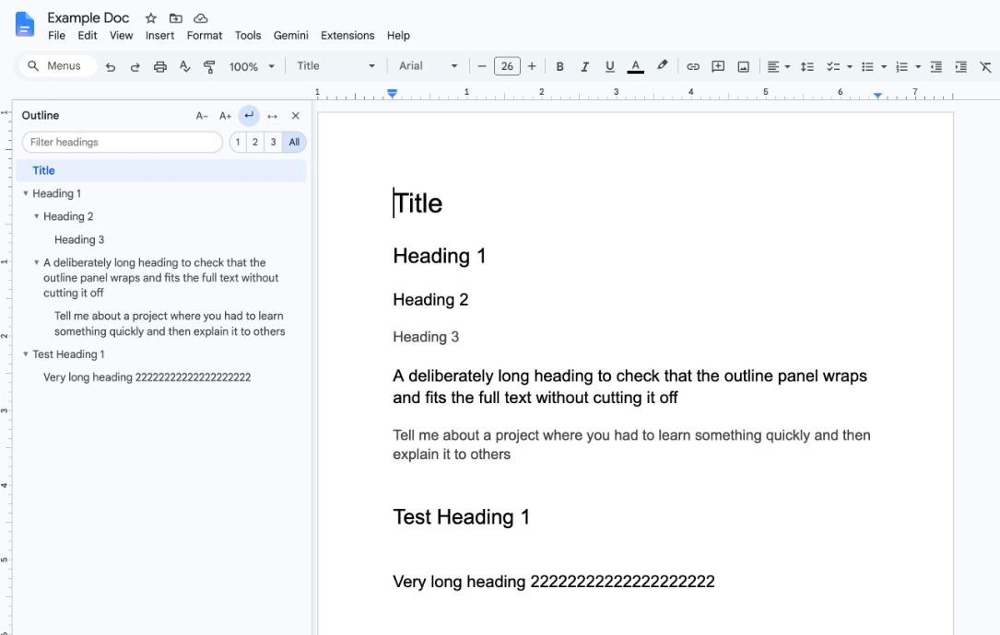

# Docs Outline Panel

A Chrome extension that replaces the Google Docs outline with a resizable
panel, so long headings show in full instead of being cut off with "…".

**Before:** the built-in outline cuts long headings off.

**After:** the panel shows every heading in full.

## Install

1. Download or clone this repo.
2. Open `chrome://extensions` and turn on **Developer mode** (top right).
3. Click **Load unpacked** and select the `gdocs-toc` folder.
4. Reload any open Google Docs tabs.

## Use

| Control | Action |
| --- | --- |
| Drag the right edge | Resize. Double-click the edge, or click ↔, to fit the longest heading. |
| ↵ | Wrap long headings, or keep each on one line |
| A− / A+ | Text size |
| 1 / 2 / 3 / All | Heading levels to show |
| ▼ / ▶ | Collapse or expand a section |
| Filter box | Show only headings containing the text |
| ✕ | Hide the panel. Click **Outline** at the bottom left to bring it back. |

Your settings carry over to every doc. The panel can't grow wider than the
gray area left of the page, so it never covers your text.

## How it works

Docs draws the page on a canvas, but its built-in outline is ordinary HTML
that holds each heading's full text. The extension hides that outline, shows
its entries in its own panel, and passes your clicks back to it so Docs does
the scrolling. It needs no permissions and makes no network requests.

## Development

After changing the code, click the reload icon on the extension's card in
`chrome://extensions`, then reload the Docs tab.

Google can change Docs' HTML at any time. If the panel stops working, check
the `SEL` selectors at the top of `content.js` and the rules in `page.css`.
